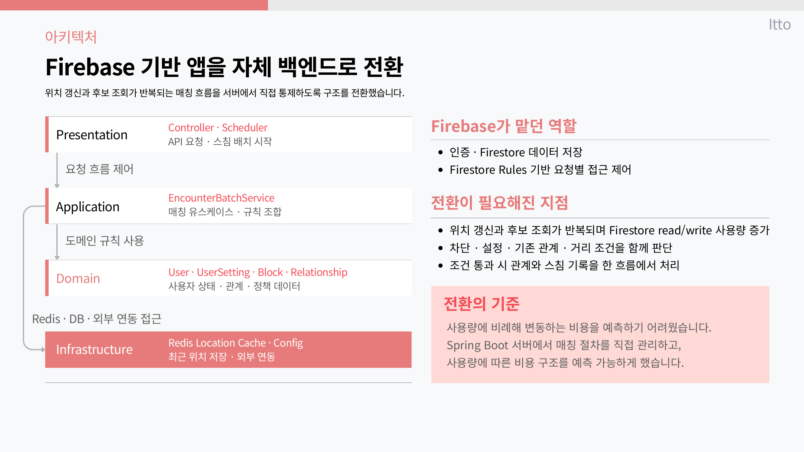
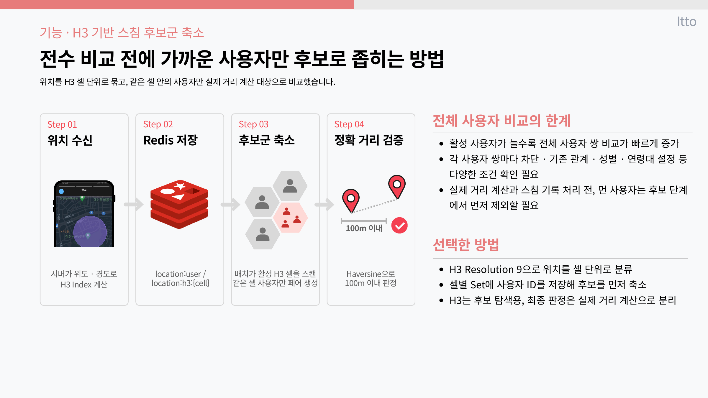
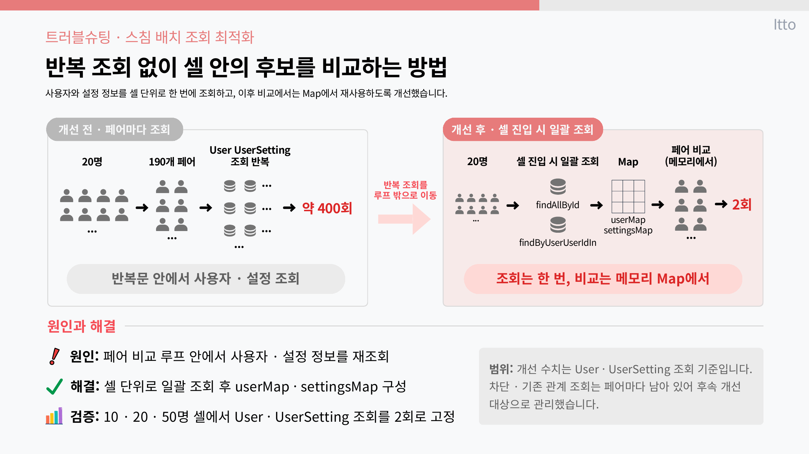

<h1 align="center">ITTO Backend</h1>

<p align="center">
  스쳐 간 사람을 다시 연결하는 위치 기반 인연 서비스의 Spring Boot API 서버
</p>

<p align="center">
  
  
  
  
  
</p>

[화면 데모](https://itto-demo.pages.dev/) · [포트폴리오 PDF](https://kr-uk.github.io/portfolio/portfolio-backend.pdf) · [Flutter 앱](https://github.com/kr-Uk/itto-frontend) · [배포 구성](https://github.com/kr-Uk/itto-server)


## 프로젝트 개요

| 항목 | 내용 |
|---|---|
| 기간 | 2026.02 ~ 2026.06 |
| 구성 | 기획 1명 · 개발 1명 |
| 담당 | Flutter 앱 · Spring Boot 백엔드 · 배포 환경 구현 |
| 핵심 | Firebase 중심 구조를 백엔드 중심 구조로 전환하고 위치 후보 탐색을 H3·Redis로 최적화 |

관련 저장소: [Flutter 앱](https://github.com/kr-Uk/itto-frontend) · [인프라](https://github.com/kr-Uk/itto-server)

## 기술 스택

| 영역 | 기술 |
|---|---|
| Backend | Java 21 · Spring Boot 3.5.10 · Spring Security · Spring Data JPA |
| Data | PostgreSQL 16 · Redis 7 · Flyway |
| Location | Uber H3 4.1.1 |
| Realtime / Push | WebSocket · STOMP · Firebase Cloud Messaging |
| Auth / Storage | Google·Kakao·Apple OAuth · JWT · MinIO |
| API | REST · Swagger / OpenAPI |

## 구조 전환

초기 Firebase 중심 구조에서는 인증, 위치 계산, 관계 상태 변경이 클라이언트에 흩어져 있었습니다.
Spring Boot 서버를 단일 진입점으로 두고 인증과 도메인 규칙을 서버에서 처리하도록 옮겼습니다.



## H3 기반 위치 후보 탐색

위도·경도 좌표를 H3 셀로 변환해 Redis에 저장하고, 배치에서 같은 셀의 사용자끼리 후보 페어를 만듭니다.
전체 사용자 쌍 대신 셀별 후보를 비교하지만, 한 셀 안의 페어 비교 자체는 사용자 수에 따라 증가합니다.

> **현재 구현의 한계:** 인접 셀까지 후보를 확장하지 않아 셀 경계 양쪽에 있는 100m 이내 사용자 쌍은 누락될 수 있습니다. 최종 100m 판정은 후보 페어에 Haversine 거리를 적용합니다.



### 쿼리 수 개선

20명이 같은 셀에 있는 경우, 페어별로 반복하던 `User`·`UserSetting` 조회가 약 400회 발생했습니다.
셀 진입 시 두 종류를 일괄 조회하고 Map에서 재사용해 **해당 조회만 약 400회에서 2회**로 줄였습니다. 차단·기존 관계 조회는 페어마다 남아 있어 별도 개선 대상입니다.



> 이 수치는 포트폴리오 제작 시 사용한 20명 기준 검증 결과입니다. 운영 규모 부하 테스트 수치는 아닙니다.

## 코드 구조

```text
src/main/java/com/itto/backend/
├── presentation/      # REST API, 요청·응답 DTO
├── application/       # 유스케이스와 서비스
├── domain/            # 엔티티, 값, 저장소 인터페이스
└── infrastructure/    # JPA, Redis, OAuth, FCM, MinIO, WebSocket
```

주요 도메인은 사용자, 프로필, 위치, 만남 기록, 관계, 채팅, 알림, 차단·신고, 결제로 나뉩니다.

## 실행

```bash
cp .env.example .env
docker compose up -d
./gradlew bootRun
```

환경 변수와 외부 OAuth·Firebase 설정이 필요합니다. 실제 비밀값과 서비스 계정 파일은 저장소에 포함하지 않습니다.

## 저장소 상태

프로젝트 종료 시점의 코드를 포트폴리오용으로 공개한 읽기 전용 저장소입니다.
